# Data Architecture & Persistence Layer

Đây là thiết kế dữ liệu đề xuất cho website bán mô hình, thẻ bài và phụ kiện; thư mục hiện chưa có mã nguồn để xác nhận cấu hình thực tế. Thiết kế dùng MySQL/InnoDB với Laravel Eloquent và migrations làm nguồn quản lý schema.

## Database Configuration

| Service/Module | DB Type | Profile | Driver | Connection | Migration Tool |
|---|---|---|---|---|---|
| Toàn ứng dụng (modular monolith) | MySQL 8 / MariaDB tương thích | Local, test, demo/production | PDO MySQL | Cấu hình qua biến môi trường; không đưa thông tin xác thực vào Git | Laravel migrations và seeders |

Schema được tạo/cập nhật bằng migration, không tự sinh từ model. Dùng InnoDB, `utf8mb4`, khóa ngoại và giao dịch cho các thao tác cập nhật dữ liệu liên quan. Mỗi môi trường có cơ sở dữ liệu riêng; thông tin kết nối lấy từ `.env`.

## Data Ownership per Service

| Service | Tables Owned | ORM Framework | Caching | Notes |
|---|---|---|---|---|
| Identity & Access | `users`, `roles`, `permissions`, `user_roles`, `role_permissions`, `admin_audit_logs` | Laravel Eloquent | Chưa cần ở phiên bản đầu | Chính sách truy cập được kiểm tra phía máy chủ |
| Catalog | `categories`, `products`, `product_images` | Laravel Eloquent | Có thể cache danh mục/chi tiết công khai sau khi đo tải | Catalog sở hữu dữ liệu sản phẩm và phân loại |
| Cart & Orders | `carts`, `cart_items`, `orders`, `order_items`, `payments`, `addresses` | Laravel Eloquent | Cart có thể lưu DB; Redis chỉ là lựa chọn mở rộng | Order item giữ snapshot tên/SKU/giá tại thời điểm đặt |
| Promotions | `promotions`, `promotion_products`, `coupons`, `coupon_redemptions` | Laravel Eloquent | Chưa cần ở phiên bản đầu | Lưu chương trình theo sản phẩm và lượt sử dụng mã |
| Content & Storefront | `posts`, `banners` | Laravel Eloquent | Có thể cache nội dung đã xuất bản | Chỉ dữ liệu đã xuất bản được hiển thị công khai |

Đây là các module logic trong một ứng dụng và một cơ sở dữ liệu; không phải các microservice độc lập.

## Entity Model

Các tên bảng/cột dưới đây là đề xuất. Quy ước: khóa chính số nguyên tăng dần; thời điểm dùng `created_at`/`updated_at`; bảng có thể khôi phục dùng `deleted_at`; giá tiền dùng `DECIMAL(12,2)`.

```mermaid
erDiagram
    users ||--o{ user_roles : "assigned"
    roles ||--o{ user_roles : "granted through"
    roles ||--o{ role_permissions : "contains"
    permissions ||--o{ role_permissions : "granted through"
    users ||--o{ addresses : "owns"
    categories o|--o{ categories : "parent has children"
    categories ||--o{ products : "classifies"
    products ||--o{ product_images : "has"
    users ||--o{ carts : "owns"
    carts ||--o{ cart_items : "contains"
    products ||--o{ cart_items : "selected as"
    users ||--o{ orders : "places"
    addresses o|--o{ orders : "used for delivery"
    coupons o|--o{ orders : "applied to"
    promotions ||--o{ promotion_products : "targets"
    products ||--o{ promotion_products : "discounted by"
    coupons ||--o{ coupon_redemptions : "redeemed through"
    users ||--o{ coupon_redemptions : "redeems"
    orders ||--o| coupon_redemptions : "records redemption"
    orders ||--|{ order_items : "contains"
    products ||--o{ order_items : "referenced by"
    orders ||--o{ payments : "has"
    users ||--o{ admin_audit_logs : "performs"
    users ||--o{ posts : "authors"
    users ||--o{ banners : "manages"

    users {
        bigint id PK
        string name
        string email UK
        string password
        string status
    }
    roles {
        bigint id PK
        string name UK
        string display_name
    }
    permissions {
        bigint id PK
        string name UK
        string display_name
    }
    user_roles {
        bigint user_id PK "also FK to users"
        bigint role_id PK "also FK to roles"
    }
    role_permissions {
        bigint role_id PK "also FK to roles"
        bigint permission_id PK "also FK to permissions"
    }
    addresses {
        bigint id PK
        bigint user_id FK
        string recipient_name
        string phone
        string address_line
    }
    categories {
        bigint id PK
        bigint parent_id FK
        string name
        string slug UK
        string status
    }
    products {
        bigint id PK
        bigint category_id FK
        string sku UK
        string name
        decimal price
        int stock_quantity
        string status
    }
    product_images {
        bigint id PK
        bigint product_id FK
        string image_path
        int sort_order
    }
    carts {
        bigint id PK
        bigint user_id FK
        string session_key UK
    }
    cart_items {
        bigint id PK
        bigint cart_id FK
        bigint product_id FK
        int quantity
    }
    orders {
        bigint id PK
        bigint user_id FK
        bigint address_id FK
        bigint coupon_id FK
        string order_number UK
        string status
        decimal total
    }
    order_items {
        bigint id PK
        bigint order_id FK
        bigint product_id FK
        string product_name
        string sku
        decimal unit_price
        int quantity
    }
    payments {
        bigint id PK
        bigint order_id FK
        string method
        string status
        string provider_reference
        decimal amount
    }
    coupons {
        bigint id PK
        string code UK
        string discount_type
        decimal discount_value
        int max_uses
        int max_uses_per_user
        int usage_count
        datetime starts_at
        datetime expires_at
    }
    promotions {
        bigint id PK
        string name
        string discount_type
        decimal discount_value
        datetime starts_at
        datetime expires_at
        string status
    }
    promotion_products {
        bigint promotion_id PK "also FK to promotions"
        bigint product_id PK "also FK to products"
    }
    coupon_redemptions {
        bigint id PK
        bigint coupon_id FK
        bigint user_id FK
        bigint order_id FK
        decimal discount_amount
        datetime redeemed_at
    }
    posts {
        bigint id PK
        bigint author_id FK
        string title
        string slug UK
        string status
    }
    banners {
        bigint id PK
        bigint manager_id FK
        string title
        string image_path
        int sort_order
    }
    admin_audit_logs {
        bigint id PK
        bigint actor_id FK
        string action
        string subject_type
        bigint subject_id
        datetime created_at
    }
```

<!-- mermaid-checked: every attribute is `<type> <name> [<key>] ["<description>"]` with at most one of PK/FK/UK, no \n in descriptions, no {} in descriptions, every relationship label is double-quoted -->

### Ràng buộc và chỉ mục đề xuất

- Duy nhất: `users.email`, `roles.name`, `permissions.name`, `categories.slug`, `products.sku`, `coupons.code`, `orders.order_number`.
- Bảng nối có khóa chính kép (`user_roles.user_id, role_id`; `role_permissions.role_id, permission_id`). `cart_items` có unique (`cart_id, product_id`).
- Chỉ mục cho `products(category_id, status)`, `products(price)`, `orders(user_id, created_at)`, `orders(status, created_at)`, và `order_items(order_id)`.
- Dùng `DECIMAL`, không dùng kiểu số thực cho tiền. Snapshot sản phẩm/giá trong `order_items` không phụ thuộc dữ liệu catalog thay đổi sau này.
- Dùng soft delete cho sản phẩm nếu cần khôi phục; không xóa cứng sản phẩm đã được tham chiếu bởi đơn hàng. Ngăn xóa danh mục còn sản phẩm con/sản phẩm đang hoạt động.
- `orders.address_id` có thể null nếu địa chỉ được snapshot trực tiếp vào đơn; nếu dùng địa chỉ tham chiếu, khi tạo đơn cần lưu thêm bản sao địa chỉ nhận hàng để lịch sử không đổi khi người dùng sửa sổ địa chỉ.

## Key Repository Methods

Các model/repository là thiết kế dự kiến; Laravel Eloquent cung cấp CRUD cơ bản, nên bảng chỉ liệt kê truy vấn nghiệp vụ cần bổ sung.

| Service | Repository / Model | Notable Methods | Purpose |
|---|---|---|---|
| Identity & Access | `User`, `Role`, `Permission` | `User::roles()`, `Role::permissions()`, `User::hasPermission(string $name)` | Nạp vai trò/quyền và kiểm tra quyền ở middleware/policy |
| Catalog | `Product` | `scopeVisible()`, `scopeSearch($query)`, `scopeFilterCategory($id)`, `scopePriceBetween($min, $max)` | Truy vấn sản phẩm đang bán, tìm kiếm và lọc |
| Catalog | `Category` | `scopeVisible()`, `children()`, `products()` | Duyệt cây danh mục và sản phẩm theo danh mục |
| Cart & Orders | `Cart` | `findForUserOrSession($userId, $sessionKey)`, `itemsWithProducts()` | Tải giỏ hàng theo người dùng hoặc phiên khách |
| Cart & Orders | `Order` | `findForCustomer($orderNumber, $userId)`, `scopeFilterStatus($status)` | Giới hạn đơn hàng theo chủ sở hữu; lọc danh sách quản trị |
| Cart & Orders | `Coupon` | `findUsableCode($code, $at)` | Tìm mã theo thời hạn/trạng thái; kiểm tra giới hạn sử dụng ở tầng dịch vụ |
| Promotions | `Promotion` | `activeForProduct($productId, $at)` | Tìm chương trình đang hiệu lực áp dụng cho sản phẩm |

Thao tác tạo đơn, ghi snapshot dòng hàng, cập nhật tồn kho và ghi nhận thanh toán phải chạy trong transaction phù hợp. Dùng khóa hàng/kiểm tra tồn kho trong transaction để tránh bán vượt tồn; không tin tổng tiền do trình duyệt gửi lên.

## Caching Strategy

Phiên bản đầu không bắt buộc cache phân tán; dùng truy vấn có chỉ mục và phân trang trước. Nếu cần tối ưu, dùng Laravel Cache với Redis cho danh mục và sản phẩm công khai, đặt TTL ngắn và xóa cache khi quản trị cập nhật sản phẩm/danh mục/banner. Không cache kết quả phân quyền nhạy cảm hoặc trạng thái tồn kho/giá phục vụ checkout nếu chưa có cơ chế vô hiệu hóa nhất quán. Giỏ hàng đăng nhập lưu trong MySQL để đồng bộ giữa phiên; Redis là lựa chọn mở rộng, không phải nguồn dữ liệu duy nhất.

## Data Ownership Boundaries

Một MySQL database được chia quyền sở hữu theo module logic. Trong modular monolith, module Orders có thể đọc Catalog qua model/service trong cùng ứng dụng, nhưng phải lưu snapshot sản phẩm và giá trong `order_items`; không cho giao diện hoặc module bên ngoài sửa trực tiếp dữ liệu catalog. Dùng transaction cho thay đổi liên quan tới đơn hàng và tồn kho. Khi tải tăng, có thể tách dịch vụ sau này nhưng chưa cần thiết cho quy mô đồ án.

### Data Classification & Sensitivity

| Entity | Sensitive Fields | Classification (PII/PHI/PCI/None) | Controls In Place |
|---|---|---|---|
| `users` | `name`, `email`, `password` | PII | Đề xuất băm mật khẩu bằng Laravel Hash; giới hạn truy cập hồ sơ theo quyền; không ghi mật khẩu/token vào log |
| `addresses` | `recipient_name`, `phone`, `address_line` | PII | Đề xuất chỉ người sở hữu và nhân viên có quyền đơn hàng được xem; dùng HTTPS và mã hóa ổ đĩa/backup ở môi trường triển khai |
| `orders` | `user_id`, thông tin giao hàng snapshot nếu lưu tại đây | PII | Đề xuất giới hạn theo chủ đơn/quyền xử lý đơn; không xuất dữ liệu khách hàng vào báo cáo công khai |
| `payments` | `provider_reference` | Dữ liệu giao dịch; không lưu dữ liệu thẻ | Không lưu PAN/CVV; chuyển thanh toán thẻ cho nhà cung cấp tuân thủ PCI, chỉ lưu mã tham chiếu và trạng thái |
| `admin_audit_logs` | `actor_id`, hành động quản trị | Dữ liệu kiểm toán | Đề xuất chỉ admin được xem; tránh lưu thông tin bí mật hoặc payload nhạy cảm |

Đây là kiểm soát được đề xuất, chưa được xác minh trong mã nguồn. Mật khẩu phải được hash; dữ liệu thẻ không được lưu trực tiếp. Cần xác định chính sách lưu trữ/xóa PII và bảo vệ backup trước khi triển khai thật.
